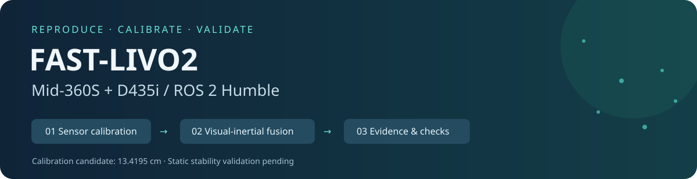
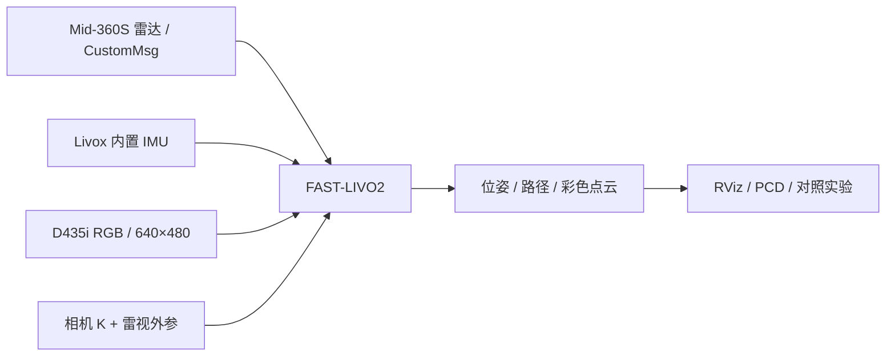

<div align="center">



# FAST-LIVO2 · Mid-360S × D435i

**从传感器标定到视觉融合，一步一步建立可复现的实验。**


[**标定手册 →**](docs/CALIBRATION_README.md)　 · 　[**融合调试 →**](docs/FASTLIVO2_DEBUG_README.md)　 · 　[**13.42 cm 外参存档 →**](calibration_archives/2026-10-17_mid360s_d435i_13p42cm/README.md)

</div>

---

## 从这里开始

| 我想做什么 | 阅读入口 | 你会得到什么 |
|---|---|---|
| 从安装好的硬件开始标定 | [标定 README](docs/CALIBRATION_README.md) | 终端分工、五组录包、初值、精优化、方向求逆、重采与验收 |
| 运行并判断 FAST-LIVO2 是否正常 | [调试 README](docs/FASTLIVO2_DEBUG_README.md) | 三路启动、参数核对、RViz、静态/动态验收、回放、保存地图 |
| 恢复这次的标定结果 | [13.4195 cm 存档](calibration_archives/2026-10-17_mid360s_d435i_13p42cm/README.md) | 原始 JSON、双向变换、相机/YAML 快照、SHA256 与实验指标 |
| 排查自动退出、段错误 | [退出诊断报告](FASTLIVO2_SHUTDOWN_DIAGNOSIS.md) | 析构崩溃证据、修复范围与尚未解释的 SIGINT |
| 对照社区移植原说明 | [上游 README 快照](docs/UPSTREAM_README.md) | 原项目背景；设备参数和并发编译命令不直接用于本机 |

## 当前进展：把“能运行”和“准确”分别验证

| 检查项 | 状态 | 证据 / 下一步 |
|---|:---:|---|
| Livox + RGB 输入、视觉更新 | ✅ | 已有实际视觉更新；单相机 RGB，不依赖双目深度 |
| 精外参数值与求逆配置 | ✅ | 基线 **13.4195 cm**，方向/单位已核对并存档 |
| 退出析构崩溃修复 | ✅ | 修复后回放加等待约 60.46 s，主动停止退出 0 |
| 多场景投影、独立留出验证 | ⏳ | 逐组检查并补独立场景 |
| 静止状态估计稳定性 | ⚠️ | 曾出现 z 范围约 24.9 cm 的波动，尚未通过 |
| 时间偏移、动态精度、长时运行 | ⏳ | 时偏当前为 0，无独立真值精度报告 |

**13 cm 尺量与 13.42 cm 基线接近，只能说明安装量级合理；不能宣称毫米级标定精度。** 当前结果作为候选保存，不作为已完成准确性验收的 SLAM 系统。

## 系统组成



| 硬件/软件 | 本机设置 |
|---|---|
| 操作系统 / 中间件 | Ubuntu 22.04 / ROS 2 Humble |
| 雷达 / 主机网卡 | Mid-360S `192.168.1.114` / `eno1 192.168.1.50/24` |
| 相机 | D435i `261722072542`，彩色 640×480@30 |
| IMU | 使用雷达内置 IMU，D435i IMU 不参与本流程 |
| 标定工具 | Koide direct_visual_lidar_calibration，Humble Docker 镜像 |
| 资源策略 | 默认算法单线程、按需开启 RViz、无需日常重新编译 |

标定驱动发 **PointCloud2**；建图驱动发 **CustomMsg**。同一时间只运行一份雷达驱动。

## 快速入口

下面只是已有环境的入口，不替代两份完整手册；全新机器先看调试手册的环境/构建章节。

```bash
# 每个终端先加载；克隆到新位置后把第一行换成实际脚本位置。
source /home/hzw/项目文件/四旋翼/livox/fast_livo2_deep_robotics/scripts/calibration_env.sh
export ROS_DOMAIN_ID=0
```

- **终端 A：** `ros2 launch livox_ros_driver2 msg_MID360s_launch.py`
- **终端 B：** 按调试手册完整命令启动 RGB，相机参数必须与存档一致。
- **终端 C：** 显式加载候选外参开启视觉；省略参数默认仅 LIO。

```bash
OMP_NUM_THREADS=1 OPENBLAS_NUM_THREADS=1 nice -n 15 \
  ros2 launch fast_livo mapping_mid360s_d435i.launch.py \
    visual_config_file:="$LIVO_WS/src/FAST-LIVO2/config/mid360s_d435i_calibrated.yaml" \
    use_rviz:=false
```

## 目录

```text
.
├── README.md                         # 本首页
├── docs/
│   ├── CALIBRATION_README.md          # 完整标定教程
│   ├── FASTLIVO2_DEBUG_README.md       # 完整融合与调试教程
│   └── UPSTREAM_README.md             # 社区原说明快照
├── calibration_archives/
│   └── 2026-10-17_mid360s_d435i_13p42cm/
│       ├── calib.json                # Koide 原始结果
│       ├── transforms.json           # 双向变换与适用性
│       ├── fastlivo2_visual.yaml      # 配置快照
│       └── SHA256SUMS                # 完整性校验
├── scripts/                          # 采集、处理、求逆、信号诊断
└── src/                              # ROS2 算法、驱动与依赖源码
```

原始 bag、预处理场景图像/PLY、构建产物、运行日志和 X11 授权只留本地。上传的来源清单含原包哈希，便于回溯；没有公开原包的独立读者不能仅靠数值档案重跑标定求解。

## 来源与许可

本仓库是针对特定硬件安装的复现工作区，基于 [DeepRoboticsLab/fast-livo2-deep-robotics](https://github.com/DeepRoboticsLab/fast-livo2-deep-robotics) 的社区 ROS2 `soft-sync` 分支，包含本机适配和资源/退出问题修复。算法原作：[hku-mars/FAST-LIVO2](https://github.com/hku-mars/FAST-LIVO2)。标定方法：[Koide](https://koide3.github.io/direct_visual_lidar_calibration/)。

保留 [原仓库 LICENSE](LICENSE) 与各子项目自己的许可/版权声明；不得把复现适配表述为原创算法。源快照依据及未复制的上游大附件见 [发布清单](PUBLISH_MANIFEST.json)。
