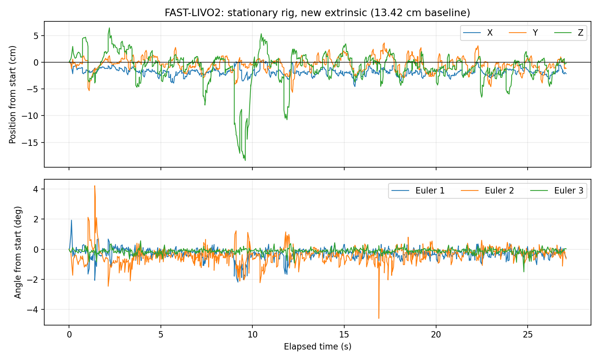

# 标定存档 · Mid-360S × D435i · 13.42 cm

[项目首页](../../README.md) · [标定全过程](../../docs/CALIBRATION_README.md) · [融合调试](../../docs/FASTLIVO2_DEBUG_README.md)

归档日期：2026-10-17；安装会话：rigid_mount_01；D435i：261722072542；RGB：640×480@30；Mid-360S IP：192.168.1.114。**仅适用于本次刚性安装。**

## 结论与边界

| 项目 | 结果 |
|---|---|
| 精外参基线 | **0.1341952988000692 m = 13.41952988 cm** |
| 用户机械估测 | 约 13 cm，仅用于数量级检查 |
| 人工初值基线 | 约 16.99 cm |
| 几何合理性 | 基线与安装同量级；不是精度证明 |
| 相机模型 | 出厂 RGB CameraInfo，未独立验证内参精度 |
| 时偏 | img/imu offset 当前均为 0，未独立标定 |
| 视觉参与 | 已有实际视觉更新证据 |
| 静态稳定性 | **未通过**：静止时出现明显位姿波动 |
| 动态精度、留出投影 | 待验证，无独立真值 |

不能把“与尺量差约 4.2 mm”写成“标定误差 4.2 mm”；尺量参考点不精确，而且基线长度吻合也可能伴随旋转错误。本套结果以候选外参存档，后续新结果应新建存档，不改写这份历史记录。

## 坐标约定

`calib.json` 是 Koide 原始结果，四元数顺序 **xyzw**，单位 **m**：

```text
p_lidar = R_lc * p_camera_optical + t_lc
T_lidar_camera = [tx, ty, tz, qx, qy, qz, qw]

translation = [0.05388161926906978, -0.111222433772993, 0.05229454608843112]
quaternion  = [0.006458528197514478, -0.640465000886392,
               0.767938834780435, 0.005728532899744435]
```

FAST-LIVO2 使用求逆后的雷达→相机光学变换：

```text
p_camera_optical = Rcl * p_lidar + Pcl
Rcl =
[-0.999850942649,  0.000525403225,  0.017257358894]
[-0.017071248296, -0.179543533101, -0.983601897214]
[ 0.002581659579, -0.983749888779,  0.179525740106]

Pcl (m) = [0.053029558693, 0.032387572528, -0.118942377943]
```

完整精度以 JSON/YAML 为准。RGB 光学系 x 右、y 下、z 前；反向求逆不改变两个原点的距离。

## 文件清单

| 文件 | 用途 |
|---|---|
| `calib.json` | 原始初值、精外参、相机模型、五组场景元数据 |
| `transforms.json` | 双向 4×4 矩阵、基线、单位、适用性和限制 |
| `fastlivo2_visual.yaml` | 可加载的候选融合配置，img_en=1 |
| `camera_rgb_640x480.yaml` | 对应 RGB 出厂参数快照 |
| `source_provenance.json` | 镜像 ID、来源包元信息、原始包 SHA256、转换消息数 |
| `static_validation.json` | 约 27 秒静置测试的指标与限制 |
| `static_drift.png` | 同次静置位姿波动图 |
| `shutdown_validation.json` | 析构修复后约 60.46 秒存活和主动停止结果 |
| `SHA256SUMS` | 本目录文件完整性校验；不包含自身 |

原始包仍留本机，未随 GitHub 分发。SHA256 可以关联来源文件，但没有原包就不能独立重跑求解。图中为位姿随时间曲线，不含采集场景图像。

## 已记录的静态问题



约 27.09 秒记录中，设备实际没有移动：xyz 估计范围约 5.0 / 9.3 / 24.9 cm，最大偏离起点约 18.6 cm，末端位移约 2.4 cm。可见 VIO 修正不等于修正正确。必须继续用同包 LIO/VIO 对照、投影、时间/IMU 排查。

该次旧构建收到 SIGINT 后 exit -11；另一次修复后的退出测试约 60.46 秒未自行停止，主动 SIGINT 后退出 0。两次实验不是同一件事：退出修复不证明静态漂移已经修好；历史 SIGINT 来源仍待确认。

## 校验与恢复

在本机任意新终端：

```bash
source /home/hzw/项目文件/四旋翼/livox/fast_livo2_deep_robotics/scripts/calibration_env.sh
ARCHIVE="$LIVO_WS/calibration_archives/2026-10-17_mid360s_d435i_13p42cm"
(cd "$ARCHIVE" && sha256sum -c SHA256SUMS)

# 独立副本，保留原存档；已经存在时不覆盖。
cp -n "$ARCHIVE/fastlivo2_visual.yaml" \
  "$LIVO_WS/src/FAST-LIVO2/config/mid360s_d435i_archived_13p42cm.yaml"
```

随后按调试手册启动雷达和 RGB，再运行：

```bash
export ROS_DOMAIN_ID=0
OMP_NUM_THREADS=1 OPENBLAS_NUM_THREADS=1 nice -n 15 \
  ros2 launch fast_livo mapping_mid360s_d435i.launch.py \
    visual_config_file:="$LIVO_WS/src/FAST-LIVO2/config/mid360s_d435i_archived_13p42cm.yaml" \
    use_rviz:=false
```

## 使用版本

源代码基于社区 ROS2 `soft-sync` 分支，当前发布源码快照与本机补丁见仓库；标定容器确切 image ID 记录于 source_provenance.json。保存数值不等于完成内参、雷达–IMU、时间同步全链验证。后续调整安装/时序/模型时请建立新的会话与存档。
