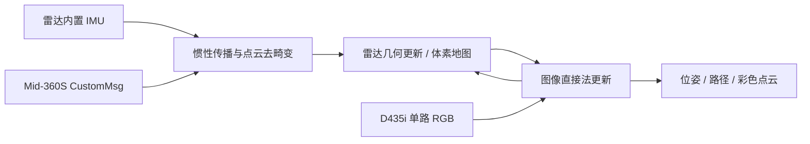

# FAST-LIVO2 从启动到验收：调试手册

[返回首页](../README.md) · [标定手册](CALIBRATION_README.md) · [13.42 cm 外参存档](../calibration_archives/2026-10-17_mid360s_d435i_13p42cm/README.md)

本手册对应当前社区 ROS 2 移植及本机补丁，Ubuntu 22.04 / ROS 2 Humble，Mid-360S + D435i 640×480@30。更新：2026-10-17。**已经有可运行的二进制；日常运行不需要编译。**

> 状态：雷达/图像链路和视觉更新已跑通；已修复经复现确认的退出析构崩溃，短时回放约 60 秒通过。但静置测试仍有明显位姿波动，尚未完成动态精度、长期稳定性、时间同步验收。请将本项目视作复现与调试工作区。

## 导航

1. [这是什么算法与版本](#1-这是什么算法与版本)
2. [环境检查](#2-环境检查)
3. [恢复候选外参](#3-恢复候选外参)
4. [实时融合：四个终端](#4-实时融合四个终端)
5. [打开 RViz 看什么](#5-打开-rviz-看什么)
6. [逐级验收](#6-逐级验收)
7. [录包与离线复现](#7-录包与离线复现)
8. [单独测试 LIO](#8-单独测试-lio)
9. [点云稀疏与建图改进](#9-点云稀疏与建图改进)
10. [保存点云与轨迹](#10-保存点云与轨迹)
11. [自动退出与其他故障](#11-自动退出与其他故障)
12. [必要时单线程编译](#12-必要时单线程编译)
13. [学习顺序](#13-学习顺序)

## 1. 这是什么算法与版本

本代码源于 [DeepRoboticsLab 的 ROS 2 移植](https://github.com/DeepRoboticsLab/fast-livo2-deep-robotics)，本地起始分支 `soft-sync`。算法来源为 [hku-mars/FAST-LIVO2](https://github.com/hku-mars/FAST-LIVO2)；本工程不是官方源码逐字未改的发布版，也不是 FAST-LIO2 改个名字。

可以这样理解处理过程：



IMU 预测运动；雷达几何约束校正状态；视觉通过地图关联的图像小块光度误差进一步约束状态。相机没有直接发布“正确位置”，彩色点云也不代表每个图像约束都正确。只有订阅图像、甚至出现 RGB 点云，都不足以单独证明定位准确。

### 本机相对社区移植的主要调整

| 位置 | 修改 | 作用与边界 |
|---|---|---|
| `LIVMapper.cpp` | 点云队列 200000→50、IMU→500、图像→30；关闭视觉时不订阅图像；高频日志降为 DEBUG | 减少内存和日志负担；不是修改滤波算法公式 |
| FAST-LIVO2 / vikit CMake | x86 去除 native 指令集编译；保留 O3 | 修复本机 Eigen/PCL 分配释放约定不一致导致的退出崩溃 |
| FAST-LIVO2 CMake | 默认 `FAST_LIVO_NUM_THREADS=1` | 避免代码强制 4 个 OpenMP 线程覆盖环境限制 |
| vikit package.xml | 明确 ament_cmake build_type | ROS 2 包构建适配 |
| launch / YAML | 单独的 Mid-360S、D435i、标定/建图入口；默认不开视觉、不开 RViz | 明确模式和参数，不把单位外参当真值 |
| scripts / docs | 数据来源检查、CustomMsg 静止转换、归档、诊断入口 | 提高可追溯性，不等于完成精度验收 |

上游 `soft-sync` 已含软同步逻辑。本机 `common.ros_driver_bug_fix=false`，不应把上游软同步标题当作本机已经硬件同步或已经标定时偏的证据。参见 [退出诊断报告](../FASTLIVO2_SHUTDOWN_DIAGNOSIS.md)。

## 2. 环境检查

### 2.1 本机每个终端先执行

```bash
source /home/hzw/项目文件/四旋翼/livox/fast_livo2_deep_robotics/scripts/calibration_env.sh
export ROS_DOMAIN_ID=0
export OMP_NUM_THREADS=1 OPENBLAS_NUM_THREADS=1
cd "$LIVO_WS"
```

| 变量 | 含义 |
|---|---|
| LIVO_WS | 当前工作区根目录，脚本根据自身位置计算 |
| LIVOX_DRIVER_WS | 外部雷达驱动工作区，默认 `/home/hzw/livox_ws` |
| CALIB_ROOT | 当前数据会话，默认 `calibration_data/rigid_mount_01`，可事先 export 覆盖 |
| ROS_DOMAIN_ID | ROS 2 发现域；本机各终端统一 0 |
| OMP/OPENBLAS 线程 | 运行阶段限制；编译还有独立限制 |

```bash
# 以下均为检查，不会编译。
ros2 pkg prefix fast_livo
ros2 pkg executables fast_livo
ros2 pkg prefix livox_ros_driver2
ros2 pkg prefix realsense2_camera
ip -br addr show eno1
ping -c 3 -W 1 192.168.1.114
free -h
pgrep -a -f 'fastlivo_mapping|rviz2|livox_ros_driver2_node'
```

确认没有旧 mapper/旧雷达驱动；在它们原终端 Ctrl+C 关闭。不要用无差别 `killall` 终止其他任务。`pgrep` 没有匹配时非零返回是正常的。现有数据/二进制只留在本机，GitHub 不包含 install/build/bag，第一次在全新机器克隆后需要第 12 节的依赖和构建。

### 2.2 常见环境缺失

本机若已可用，跳过安装。仅缺少这些工具时再执行对应安装：

```bash
sudo apt update
sudo apt install python3-numpy python3-scipy python3-yaml \
  python3-colcon-common-extensions python3-rosdep \
  ros-humble-rqt-image-view ros-humble-rosbag2-storage-default-plugins \
  strace xauth
```

Docker 用于离线标定，不是实时融合依赖。RealSense USB 驱动、SDK2 和本机外部 Livox 驱动已配置；不要为了日常运行重新编译/重装整套 SDK。新机器的完整构建见第 12 节，不能把旧安装目录直接搬过去。

## 3. 恢复候选外参

当前源码中 `mid360s_d435i_calibrated.yaml` 已保存 13.42 cm 候选。如预处理新数据把它归档了，可恢复一份**独立的新文件**：

```bash
cd "$LIVO_WS"
ARCHIVE="$LIVO_WS/calibration_archives/2026-10-17_mid360s_d435i_13p42cm"
(cd "$ARCHIVE" && sha256sum -c SHA256SUMS)

# 不覆盖已有配置；若文件已存在，cp -n 会保留它。
cp -n "$ARCHIVE/fastlivo2_visual.yaml" \
  "$LIVO_WS/src/FAST-LIVO2/config/mid360s_d435i_archived_13p42cm.yaml"
VISUAL_CONFIG="$LIVO_WS/src/FAST-LIVO2/config/mid360s_d435i_archived_13p42cm.yaml"
```

只适用于同一刚性安装、序列号 261722072542、RGB 640×480。同相机换分辨率会改变 K，支架动了会改变外参。使用新一轮结果时，把 VISUAL_CONFIG 改成新 YAML 的绝对路径。

## 4. 实时融合：四个终端

### 4.1 终端 A：建图专用 CustomMsg 驱动

```bash
source /home/hzw/项目文件/四旋翼/livox/fast_livo2_deep_robotics/scripts/calibration_env.sh
export ROS_DOMAIN_ID=0
# 先停止标定用 PointCloud2 驱动，本命令要独占雷达。
ros2 launch livox_ros_driver2 msg_MID360s_launch.py
```

建图用 CustomMsg 保留逐点时间、line 等信息；标定入口的 PointCloud2 不可直接代替。不要同时开 Viewer2、FAST-LIO2 驱动或另一份 Livox 驱动。

### 4.2 终端 B：只开 RGB

```bash
source /home/hzw/项目文件/四旋翼/livox/fast_livo2_deep_robotics/scripts/calibration_env.sh
export ROS_DOMAIN_ID=0
ros2 launch realsense2_camera rs_launch.py \
  camera_namespace:=camera camera_name:=camera \
  serial_no:=_261722072542 \
  enable_color:=true rgb_camera.color_profile:=640x480x30 \
  enable_depth:=false enable_infra:=false enable_infra1:=false enable_infra2:=false \
  enable_gyro:=false enable_accel:=false \
  enable_rgbd:=false enable_sync:=false align_depth.enable:=false
```

### 4.3 终端 C：确认类型，启动视觉融合

```bash
source /home/hzw/项目文件/四旋翼/livox/fast_livo2_deep_robotics/scripts/calibration_env.sh
export ROS_DOMAIN_ID=0
export OMP_NUM_THREADS=1 OPENBLAS_NUM_THREADS=1
cd "$LIVO_WS"

# 必须是 livox_ros_driver2/msg/CustomMsg，且发布者为 1。
ros2 topic info /livox/lidar
ros2 topic info /camera/camera/color/image_raw

# 使用当前 13.42 cm 候选；如果换了结果，在这里换绝对路径。
VISUAL_CONFIG="$LIVO_WS/src/FAST-LIVO2/config/mid360s_d435i_calibrated.yaml"
test -f "$VISUAL_CONFIG" && echo "配置存在"

# 不加 timeout，不开 RViz；该命令会一直占用终端，正常情况下不会十几秒自动退出。
nice -n 15 ros2 launch fast_livo mapping_mid360s_d435i.launch.py \
  visual_config_file:="$VISUAL_CONFIG" use_rviz:=false
```

如上一步用的是存档副本，在本终端重新设置 `VISUAL_CONFIG=...archived_13p42cm.yaml`。终端之间普通 shell 变量不会自动共享。

设备先静止数秒，让 IMU 初始化；首次验证先静置观察。静置通过后，再缓慢移动/转动整个刚性组件。不要拿着相机单独转动；初始化阶段不要晃动。

**注意默认模式：**如果省略 `visual_config_file`，此 launch 默认加载 `mid360s_d435i_lio.yaml`，即只做雷达惯性。节点名字相同不能据此判断已做视觉融合。

### 4.4 终端 D：检查是否真正运行

```bash
source /home/hzw/项目文件/四旋翼/livox/fast_livo2_deep_robotics/scripts/calibration_env.sh
export ROS_DOMAIN_ID=0
ros2 node list
ros2 param get /laserMapping common.img_en
ros2 param get /laserMapping common.img_topic
ros2 param get /laserMapping extrin_calib.Pcl
ros2 param get /laserMapping extrin_calib.Rcl
ros2 node info /laserMapping

# 以下查询各只运行 8 秒；不会停止 C 的建图节点。
timeout --signal=INT 8s ros2 topic hz /aft_mapped_to_init
timeout --signal=INT 8s ros2 topic hz /cloud_registered

# width 要持续有非零值；偶尔空帧不能单独断言整个算法失败。
ros2 topic echo /cloud_registered --once --field width
ros2 topic echo /aft_mapped_to_init --once --field pose.pose
ros2 topic info /camera/camera/color/image_raw --verbose
```

预期：`common.img_en=1`，相机话题订阅者中有 `/laserMapping`，位姿持续输出；C 日志初始化后出现 VIO 特征/地图点更新。启动初期短暂 `[ VIO ] No point!!!` 可由视觉地图尚未建立导致；持续出现则不应验收通过。

出现非零 `Append ... new visual map points`、检索特征及有实际状态更新，属于视觉模块参与工作的证据；**不是准确率或外参正确的证据**。本次文本日志可见 VIO 位置修正比例约 58%，其含义不是“58% 内点率”。

## 5. 打开 RViz 看什么

链路稳定后再打开一个 RViz，避免起步就增加桌面负担。终端 D：

```bash
# 先保持 mapper 和传感器运行，再启动 RViz。
rviz2
```

手动设置一个轻量视图：

1. Global Options → **Fixed Frame = camera_init**。这是地图参考系，不要设成跟着雷达移动的 body/lidar。
2. Add → By topic → `/cloud_registered` → PointCloud2。
3. 点大小先 2 pixel；视觉模式选择 **RGB8**，如果查看的是无 RGB 的 LIO 点云则选 Intensity。
4. Decay Time 先设 **1–3 秒**看当前数据，再用 10–20 秒检查短轨迹积累。不要一开始无限累积几十分钟。
5. Reliability 按发布者 QoS 设置；如果有 QoS 警告，先 `ros2 topic info /cloud_registered --verbose` 核对，别只改显示颜色。
6. Add `/path`（Path）观察轨迹；可加 TF 看坐标系。

也可以用社区完整配置，但其中有很长 Decay Time 和许多显示项，低内存机器先不要使用：

```bash
rviz2 -d "$(ros2 pkg prefix --share fast_livo)/rviz_cfg/fast_livo2.rviz"
```

**红色不是差、蓝绿不是好。** Intensity 是回波强度伪彩色；AxisColor 是坐标/高度着色；RGB8 是真实图像颜色。它们均不默认代表配准残差。判断建图质量要看墙面厚度、边缘重影、轨迹连续性及独立误差。

视觉模式的 `/cloud_registered` 在源码里只发布可投影进相机视野的着色点，所以会比 360° 原始雷达窄、少。它不是全局完整体素地图的直接点数，也不是每次把所有历史点重发。

## 6. 逐级验收

按顺序做；前一层没过先修前一层，不靠调大点大小掩盖问题。

| 等级 | 怎么做 | 通过标准 | 当前状态 |
|---|---|---|---|
| ① 传感器链路 | 检查话题类型、频率、单发布者 | CustomMsg/IMU/RGB 持续有数据 | 已跑通 |
| ② 模式正确 | 查 img_en、订阅关系、加载的外参 | 视觉开启，确实加载本轮结果 | 已跑通 |
| ③ 视觉参与 | 观察初始化后的 VIO 日志、实际更新 | 有持续有效地图/图像更新 | 有证据 |
| ④ 静态稳定 | 放稳后连续观察 60–120 秒，记录位置姿态范围 | 满足自己任务精度，不能明显漂移/振荡 | 先前约 27 秒记录未通过 |
| ⑤ 慢速运动 | 慢走数米、转弯、回看同一墙面 | 轨迹连续、墙面无明显双层 | 待做 |
| ⑥ 回到起点 | 绕一小圈，测起终位置和朝向差 | 记录误差，不假设自动闭环 | 待做 |
| ⑦ 重复性与对照 | 同一 bag 分别跑 LIO/视觉、重复运行 | 误差和失败率可解释 | 待做 |
| ⑧ 独立真值 | 动捕/可靠参考轨迹，时间对齐后评估 | 报 ATE/RPE、运行资源、失败率 | 未做 |

静态验收建议先自定门槛，例如初始化后 60 秒位置范围不超过 2–5 cm、姿态范围不超过 1°；这只是入门工程目标，不是官方算法保证。根据应用需求调整并记录，不能事后改门槛来让结果“通过”。

当前 13.42 cm 记录：xyz 范围约 `[5.0, 9.3, 24.9] cm`；最大离起点约 18.6 cm；姿态峰峰值约 `[4.12°, 8.83°, 2.07°]`。用户确认设备没有动，所以还需要继续排查，不能当作真实运动。参见[完整存档](../calibration_archives/2026-10-17_mid360s_d435i_13p42cm/README.md)。

## 7. 录包与离线复现

### 7.1 录一段可复现的融合测试

A、B 驱动正常，C 是否同时运行 mapper 取决于机器负载。内存紧时先只录传感器，录完再离线运行。终端 D：

```bash
source /home/hzw/项目文件/四旋翼/livox/fast_livo2_deep_robotics/scripts/calibration_env.sh
export ROS_DOMAIN_ID=0
mkdir -p "$CALIB_ROOT/fusion_bags"
BAG_PATH="$CALIB_ROOT/fusion_bags/run_$(date +%Y%m%d_%H%M%S)"
printf '记录到：%s\n' "$BAG_PATH"
ros2 bag record --storage sqlite3 --max-cache-size 33554432 \
  -o "$BAG_PATH" /livox/lidar /livox/imu \
  /camera/camera/color/image_raw /camera/camera/color/camera_info
```

先静止，再慢移/转动，最后静止；记下实际动作、持续时间、是否触碰支架。约 30–60 秒即可作为首轮对照。录完在录包终端 Ctrl+C，等待正常写入 metadata.yaml：

```bash
ros2 bag info "$BAG_PATH"
```

原始 RGB 体积较大，不要盲目录屏幕录制/多份 bag 同时写盘。bag 留本地，GitHub 默认忽略它们。

### 7.2 离线回放

先停止 A、B 的实时驱动和旧 mapper，只保留一组数据源；新 mapper 会重新初始化。分别开两终端。

回放前，终端 C 使用第 4.3 节启动视觉 mapper。该实时 launch 没有默认启用 use_sim_time；下面首轮回放保持默认系统时钟，不给 bag 加 `--clock`。内部运动主要用传感器 header，但本工程发布点云还使用节点当前时钟；后续如改 sim_time，应成套核对所有输出时间和 TF，不能混用。

回放终端：

```bash
source /home/hzw/项目文件/四旋翼/livox/fast_livo2_deep_robotics/scripts/calibration_env.sh
export ROS_DOMAIN_ID=0
# 改成上面录到的真实目录；不要把示例文字当文件名。
# 可先列出目录，复制你要使用的一个绝对路径。
find "$CALIB_ROOT/fusion_bags" -mindepth 1 -maxdepth 1 -type d
```

选择一个目录后：

```bash
# 交互输入刚才列出的完整 bag 目录，不含额外引号。
read -r -p '输入 bag 绝对路径：' BAG_PATH
ros2 bag info "$BAG_PATH"
# 数据密集时先半速。比较轨迹时记录 rate，性能评估需另外按 1.0 倍测试。
ros2 bag play "$BAG_PATH" --rate 0.5
```

不要 `--loop`；时间戳回跳会触发清缓冲，影响比较。bag 播放完成不等于 mapper 应自动退出；等待观察后在 C 手动 Ctrl+C 正常收尾。一次只运行一个 mapper，避免同名节点和输出话题互相干扰。

## 8. 单独测试 LIO

为了定位视觉引入的影响，同一包先后跑 LIO 和视觉。**这仍然是 FAST-LIVO2 代码的 LIO 模式，不等于独立的官方 FAST-LIO2 仓库。**

停止旧 mapper。A 保持 CustomMsg 驱动（或者使用离线 bag，不二者同时），B 相机可关闭以降负载：

```bash
source /home/hzw/项目文件/四旋翼/livox/fast_livo2_deep_robotics/scripts/calibration_env.sh
export ROS_DOMAIN_ID=0
OMP_NUM_THREADS=1 OPENBLAS_NUM_THREADS=1 nice -n 15 \
  ros2 launch fast_livo mapping_mid360s_d435i.launch.py use_rviz:=false
```

检查终端：

```bash
ros2 param get /laserMapping common.img_en
# 应为 0。记录与视觉模式相同的静置/动态指标。
ros2 topic echo /aft_mapped_to_init --once --field pose.pose
```

- LIO 同样静置波动大：先查 IMU 重力模长/单位、雷达–IMU 外参、时间、有效点和场景几何。
- LIO 稳定而开启视觉后变差：重点查 RGB 外参求逆、内参/畸变、图像时偏、曝光和视觉约束。
- 这种对照用于缩小原因范围，不能单次就证明所有问题都来自某一个参数。

## 9. 点云稀疏与建图改进

先区分三种“点”：原始雷达返回、算法用于估计的下采样点、发布给 RViz 的显示点。日志的分段点数不等于一整帧原始点数；当前静态记录的中位 104 点指算法片段。

| 原因 | 原理 | 怎么改/验证 |
|---|---|---|
| 非重复扫描 | 单帧只覆盖部分方向，时间积累可补采样 | 对比原始单帧与静止积累；不能无限增加新视角 |
| `point_filter_num=3` | 预处理抽点，减少计算 | 稳定后一次只改成 2 做对照，不直接改一串参数 |
| `filter_size_surf=0.1` | 体素下采样，近邻点合并 | 可试 0.08 m；点变多会增加负载 |
| 地图体素结构 | 地图保留几何约束，不是原始点全量仓库 | 不用地图点数当传感器吞吐 |
| RGB 视场裁剪 | 视觉发布只包含投影到相机视野的点 | 对照 `/livox/lidar` 与视觉输出 |
| RViz 大小、透明度、Decay | 改变可见效果，不增加实际测量 | 点大小 2–3，Alpha=1，先短积累 |
| 场景遮挡/无回波 | 玻璃、近场盲区、遮挡不会靠参数长出数据 | 换角度/场景，排除支架遮挡 |
| 支架只静置 | 不能看到墙后、物体背面或走廊另一端 | 通过静态验证后再慢速覆盖新区域 |

做参数对照时先复制，不改存档：

```bash
cd "$LIVO_WS"
python3 - <<'PY'
from pathlib import Path
import yaml
src=Path('src/FAST-LIVO2/config/mid360s_d435i_calibrated.yaml')
out=src.with_name('mid360s_d435i_density_trial.yaml')
assert not out.exists(), '试验配置已存在，请换新名称'
d=yaml.safe_load(src.read_text())
d['/**']['ros__parameters']['preprocess']['point_filter_num']=2
out.write_text(yaml.safe_dump(d,sort_keys=False))
print(out.resolve())
PY
```

停止旧 mapper，然后在第 4.3 节把 VISUAL_CONFIG 换成输出路径。比较同一 bag、相同回放速率、相同 RViz 设置下的效果和 CPU/RSS；参数改完更卡就回退，密度不等于精度。当前 `map_sliding_en=false`，长期大范围运行地图可能持续增长；短时试验通过后再单独验证滑动地图设置。

类似示例的完整房间地图，需要设备运动覆盖、正确时序/外参、稳定估计及多帧积累；截图常叠加更多视角并使用高度伪彩色。静止等待不能等价复现一段房间巡航。FAST-LIVO2 的里程计建图本身也不等于已接入全局回环优化。

## 10. 保存点云与轨迹

当前默认 `pcd_save_en=false`，不会自动生成可交付全局 PCD。首次实验先用**分块保存**降低无限缓存风险，不选 interval=-1 把所有点一直攒在内存中。

```bash
cd "$LIVO_WS"
mkdir -p src/FAST-LIVO2/Log/PCD src/FAST-LIVO2/Log/result
python3 - <<'PY'
from pathlib import Path
import yaml
src=Path('src/FAST-LIVO2/config/mid360s_d435i_calibrated.yaml')
out=src.with_name('mid360s_d435i_save_trial.yaml')
assert not out.exists(), '配置已存在，请换新名称'
d=yaml.safe_load(src.read_text());p=d['/**']['ros__parameters']
p['pcd_save']['pcd_save_en']=True
p['pcd_save']['interval']=50
p['evo']['pose_output_en']=True
p['evo']['seq_name']='mid360s_d435i_save_trial'
out.write_text(yaml.safe_dump(d,sort_keys=False))
print(out.resolve())
PY
```

在 C 启动时传这个新 YAML；按发布次数约每 50 次保存一块，不保证正好 5 秒。保存路径由编译时 ROOT_DIR 决定，本机构建为 `src/FAST-LIVO2/Log/PCD/`，不是启动终端当前目录。分块保存的最后不足一块可能不落盘；首次用已完成块验证，不把它当完整无遗漏数据备份。

```bash
# 运行一小段后，在检查终端看是否产生文件。
ls -lh "$LIVO_WS/src/FAST-LIVO2/Log/PCD"
ls -lh "$LIVO_WS/src/FAST-LIVO2/Log/result"
```

在 C Ctrl+C 正常结束，然后另建实验目录复制产物；下次保存可能复用 1.pcd 等名称，先备份旧实验。

```bash
RUN_OUT="$CALIB_ROOT/map_exports/run_$(date +%Y%m%d_%H%M%S)"
mkdir -p "$RUN_OUT"
cp -a "$LIVO_WS/src/FAST-LIVO2/Log/PCD" "$RUN_OUT/"
cp -a "$LIVO_WS/src/FAST-LIVO2/Log/result" "$RUN_OUT/"
printf '保存到：%s\n' "$RUN_OUT"
```

用 CloudCompare 打开多个已保存 PCD，检查同一墙面和边缘是否重叠一致，确认后再合并；本机如没有 CloudCompare，先用已有 RViz 短时观察，不为截图编译大型可视化工具。PCD 与 bag 默认不上 GitHub，避免体积和场景信息混入代码库。

## 11. 自动退出与其他故障

### 11.1 终端 C 十几秒自动返回提示符

这不是正常固定运行时长。先保留终端末尾信息；不要只看窗口消失就推断 OOM。A/B 照常运行，C 用下面入口替代普通启动：

```bash
source /home/hzw/项目文件/四旋翼/livox/fast_livo2_deep_robotics/scripts/calibration_env.sh
export ROS_DOMAIN_ID=0
# 此脚本使用当前 calibrated.yaml；若测试其他配置先核对脚本配置行。
# 不限制 mapper 时长，记录输出、信号、进程标识。
bash "$LIVO_WS/scripts/run_fusion_diagnostics.sh"
```

它会打印本次 `fusion_diagnostics_*` 目录；结束后有 console.log、signals.log、processes.log、exit_code.txt 和加载配置副本。

```bash
# 输入本次终端打印的完整目录，避免误分析上一轮。
read -r -p '输入本次诊断目录：' DIAG_DIR
cat "$DIAG_DIR/exit_code.txt"
rg -n 'SIGINT|SIGTERM|SIGSEGV|SIGABRT|killed by' "$DIAG_DIR/signals.log"
tail -60 "$DIAG_DIR/console.log"
# 检查内核是否记载 OOM；当前用户权限可能不允许读全部日志。
journalctl -k -b --no-pager | rg -i 'out of memory|oom-kill|killed process' | tail -20
```

| 证据 | 解释 |
|---|---|
| 收到 SIGINT，随后 launch 打印 user interrupted | 不足以证明用户按了 Ctrl+C；也可能是外部程序发送信号，查 si_pid |
| SIGSEGV / 节点 exit code -11 | 段错误，需调用栈，不能解释成正常结束 |
| SIGKILL/-9 + 内核 OOM 记录 | 有依据判断内存不足；仅 -9 还不够 |
| Exception / missing file | 先修文件、参数、环境错误 |
| 进程还在但画面不动 | 排查输入停止、时间等待、RViz Fixed Frame/显示选项 |

已确认并修复的是：原 native 构建导致本机 Eigen/PCL 释放不匹配，收到停止信号后在析构阶段崩溃。修复后回放加等待约 60.46 秒，随后主动 SIGINT，正常退出码 0。**历史未知 SIGINT 的发送者尚未查明**，不能把析构修复等同于解释了所有自动停止。

### 11.2 常见故障表

| 现象 | 按顺序排查 |
|---|---|
| node list 空 | 驱动终端是否运行 → 所有终端 source → DOMAIN_ID/RMW 一致 → ros2 daemon stop/start |
| 图像订阅者为 0 | mapper 是否存活 → img_en=1 → common.img_topic 是否准确 |
| 永久 No point | 有效雷达/视觉点、场景纹理、外参方向、K 和图像尺寸、时间是否一致 |
| RViz 卡住 | 先查 hz → Fixed Frame=camera_init → 减少 Decay 和显示项 → 查内存 |
| 转动雷达画面不变 | 雷达自身系的当前扫描可能不直观；看世界系轨迹和墙面、核对新时间戳 |
| 静置波动 | 同包 LIO/VIO 对照 → IMU 单位重力/外参 → RGB 外参/K/时序 |
| 手动改配置没生效 | 查实际传入绝对路径、ros2 param get，停止旧 mapper 重启 |
| 加速运动才重影 | 时偏、RGB 滚动快门/曝光、IMU 时间/逐点时间，先慢速对照 |
| 内存持续升高 | 停止冗余 RViz/预览/录包；查地图增长与队列，不盲目加线程 |

只读检查资源：

```bash
free -h
ps -eo pid,comm,%cpu,rss --sort=-rss | head -15
# rss 单位通常是 KiB；nice 只能降低调度优先级，不限制内存。
```

## 12. 必要时单线程编译

**本机已有可用构建，运行与读文档跳过本节。** 只在改 C++、缺少可执行文件或全新机器初始化时构建。每次只编必要包；不要 `-j$(nproc)`、不要多工作区同时编译。

### 12.1 全新机器的前置条件

需先安装 Ubuntu22.04 对应 ROS2 Humble、兼容的 RealSense ROS 驱动及 USB 规则、Livox-SDK2 和 ROS2 Livox 驱动。当前项目沿用外部驱动工作区；新机完成驱动构建后，必须使该 overlay 提供 `msg_MID360s_launch.py` 和正确的 `MID360s_config.json`，而不只是普通 Mid360 文件。

```bash
# 新机：先装算法依赖；现有机器不重复执行。
source /opt/ros/humble/setup.bash
sudo apt update
sudo apt install ros-humble-pcl-ros ros-humble-compressed-image-transport \
  ros-humble-sophus libopencv-dev libeigen3-dev libgoogle-glog-dev libgflags-dev \
  python3-colcon-common-extensions python3-rosdep

# rosdep init 仅第一次安装 rosdep 时执行；已初始化提示可跳过。
# sudo rosdep init
rosdep update
```

克隆地址为本私有仓库，使用自己已授权的 GitHub SSH/HTTPS 登录；不要把 token 写进命令、README 或 remote URL。

```bash
# 仅新机/新目录执行，不在现有工作区里嵌套克隆。
git clone https://github.com/yiwancibeishang123/FAST-LIVO2-Mid360S-D435i.git
cd FAST-LIVO2-Mid360S-D435i
# 按实际路径指定已构建好的雷达驱动 overlay。
export LIVOX_DRIVER_WS=/home/hzw/livox_ws
source "$LIVOX_DRIVER_WS/install/setup.bash"
ros2 pkg prefix livox_ros_driver2
rosdep install --from-paths src/FAST-LIVO2 src/rpg_vikit --ignore-src -r -y --rosdistro humble
```

若缺 Livox-SDK2 或相机原生 SDK，按 [Livox 官方驱动说明](https://github.com/Livox-SDK/livox_ros_driver2) 和 [RealSense ROS 官方说明](https://github.com/realsenseai/realsense-ros)完成基础驱动。不同内核、SDK、USB 情况不能保证一条安装命令通用；不要同时混装 apt 和源码版 librealsense。上游全栈历史流程另存于 [UPSTREAM_README](UPSTREAM_README.md)，其中并发编译和设备参数需要按本机改正。

### 12.2 只编算法依赖和 mapper

```bash
# 当前已配置本机，从工作区运行这一段即可；不要同时运行标定 Docker/RViz。
cd /home/hzw/项目文件/四旋翼/livox/fast_livo2_deep_robotics
source /opt/ros/humble/setup.bash
source /home/hzw/livox_ws/install/setup.bash
export OMP_NUM_THREADS=1 OPENBLAS_NUM_THREADS=1
export MAKEFLAGS=-j1
export CMAKE_BUILD_PARALLEL_LEVEL=1

# 子 shell 内限制单进程虚拟地址空间约 3 GiB；不会改掉父终端限制。
# 内存不足时让构建报错退出，保留日志，不自动提高并发或限制。
(
  ulimit -v 3145728
  nice -n 15 colcon build --executor sequential --parallel-workers 1 \
    --packages-select vikit_common vikit_ros fast_livo \
    --symlink-install \
    --cmake-args -DCMAKE_BUILD_TYPE=Release -DFAST_LIVO_NUM_THREADS=1
)

# 仅当上一步成功再加载新结果。
source install/setup.bash
ros2 pkg executables fast_livo
```

新机在克隆目录执行上述命令时换掉固定 cd 和 driver 路径。`ulimit` 是单进程约束，不是全系统内存上限；nice 也不保证绝不卡顿。出错先看 colcon 日志，不编译无关包，不清空整个 build/install 逼迫全量重建。

## 13. 学习顺序

| 顺序 | 基础 | 在本工程里对应什么 |
|---|---|---|
| 1 | ROS2 node/topic/type/QoS、时间戳、TF、bag | 能判定无输入还是无显示 |
| 2 | 旋转矩阵、四元数、齐次变换、坐标求逆 | 解释 Rcl/Pcl 和雷达–IMU 外参 |
| 3 | 针孔投影、K/D、光度与曝光、滚动快门 | 理解标定和直接视觉法为何失效 |
| 4 | IMU 加速度/角速度、重力、偏置、噪声 | 理解初始化和惯性传播 |
| 5 | 概率、雅可比、EKF/迭代误差状态滤波 | 理解预测与观测更新 |
| 6 | 点到平面残差、体素地图、可观测性 | 理解 LIO 与退化场景 |
| 7 | 图像金字塔、小块光度误差、鲁棒估计 | 理解 VIO 如何利用雷达地图 |
| 8 | 时间同步、外参、ATE/RPE、对照实验 | 从“能运行”走向可验证复现 |

阅读代码建议顺序：`main.cpp` → `LIVMapper.cpp` 参数/回调/同步/主循环 → `preprocess.cpp` → `IMU_Processing.cpp` / `include/IMU_Processing.h` → `voxel_map.cpp` → `vio.cpp`。实际文件名用 `rg --files src/FAST-LIVO2` 核对；先追一个点和一个图像从输入到输出的路径，再深入公式。官方仓库论文入口用于算法原理，本项目补丁用于解释本机运行差异，两者分别记录。
